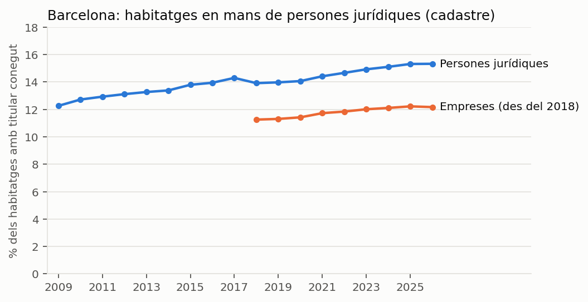
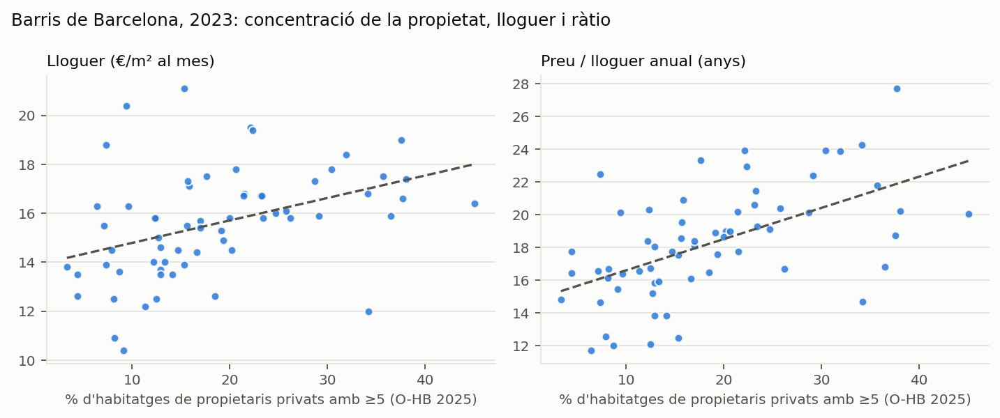
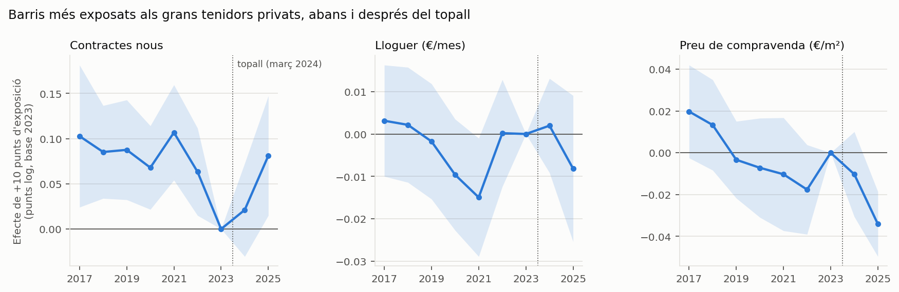

# Concentració del mercat de lloguer

## Pregunta central

Hi ha **poder de mercat en el lloguer** a Barcelona? I si n'hi ha, quina part es
**capitalitza en el preu de compra**?

Model mental de partida: si els propietaris poden fixar el preu del lloguer per sobre del
competitiu, el preu de compra també puja, perquè un habitatge val el valor present dels
lloguers que genera. Per això el focus és el **parc de lloguer**. El parc total és només context.

Concentració i poder de mercat no són el mateix. El poder de mercat depèn de tres coses:
la quota de cada propietari, la mida del **mercat rellevant** (on poden anar els llogaters
si un propietari apuja el preu) i la capacitat de **retenir oferta** (deixar pisos buits).

Àmbit: primer Barcelona ciutat. Després, l'AMB.

## Marc teòric

### 1. Propietari gran amb una franja competitiva

Un propietari gran no competeix només amb els altres grans. Competeix amb milers de petits
propietaris que poden posar pisos al lloguer o treure'n: vendre'ls a algú que hi vulgui
viure, deixar-los buits, o passar-los a lloguer de temporada o a ús turístic. És el model
d'empresa dominant amb franja competitiva:

```
Lᵢ = sᵢ / (ε_d + ε_f · (1 − sᵢ))
```

- `Lᵢ = (p − c) / p`: marge del propietari i.
- `sᵢ`: quota del propietari i en el mercat de lloguer.
- `ε_d`: elasticitat de la demanda de lloguer del mercat.
- `ε_f`: elasticitat de l'oferta de la resta de propietaris (la franja).

Amb `ε_f = 0` és el cas de Cournot. Marges amb `ε_d = 0,5` (valors il·lustratius):

| Quota del grup | ε_f = 0 | ε_f = 1 | ε_f = 2 | ε_f = 5 |
|---|---|---|---|---|
| 1 % | 2,0 % | 0,7 % | 0,4 % | 0,2 % |
| 5 % | 10,0 % | 3,4 % | 2,1 % | 1,0 % |
| 10 % | 20,0 % | 7,1 % | 4,3 % | 2,0 % |
| 20 % | 40,0 % | 15,4 % | 9,5 % | 4,4 % |

**Llindar que cal comprovar.** Per tenir un marge del 5 %, un sol grup necessitaria entre el
2,5 % (`ε_f = 0`) i l'11 % (`ε_f = 2`) del parc de lloguer del mercat. A la ciutat de
Barcelona (240.369 habitatges llogats) això són entre uns **6.000 i 27.000 habitatges**.
En un barri, el nombre absolut és molt més petit, però la demanda també és més elàstica.

### 2. Capitalització en el preu de compra

```
P = Σₜ E[Rₜ] / (1 + r)ᵗ  ≈  R / (r − g)
```

Si el poder de mercat apuja el lloguer de mercat un `μ %` i s'espera que duri, el preu
puja aproximadament un `μ %`. Perquè passi calen tres condicions:

1. **Efecte paraigua.** El marge ha d'apujar el lloguer de *mercat*, no només el dels pisos
   del gran propietari. Amb una franja competitiva passa: si el gran reté oferta, puja el
   lloguer de tothom, també el dels petits. Llavors tots els pisos de lloguer el capitalitzen.
2. **Arbitratge entre llogar i comprar.** Perquè pugi també el preu dels pisos per viure-hi,
   les llars han de poder passar de llogar a comprar. Si moltes llars no tenen accés al
   crèdit, l'arbitratge és parcial i el preu de compra en capitalitza menys. Això enllaça
   amb el tema *crèdit*.
3. **Persistència esperada.** Si el mercat espera que la regulació retalli el marge, el preu
   en capitalitza menys.

Conseqüència: **la ràtio preu/lloguer no detecta el poder de mercat**, perquè preu i lloguer
pugen junts. Cal variació en la concentració entre barris, o un xoc (vegeu P3 i P4).

### 3. Mercats locals

Watson & Ziv troben, per a Nova York, una relació entre concentració de la propietat per
*census tract* i lloguers, i un test de poder de mercat amb xocs fiscals. Enllaça amb el tema
*model de localització*: la mida del mercat rellevant surt de les elasticitats creuades entre
barris.

## Què sabem ja

Només fonts primàries: informes originals, textos legals i dades. No fem servir premsa.

### Parc de lloguer (1 de gener de 2023)

Font: [O-HB, *Estructura i concentració de la propietat del parc de lloguer a la demarcació de Barcelona 2023*](https://recam.amb.cat/bitstreams/080a7897-75e0-49ce-b8c2-e022b583dbec/download)
(gener 2024). Dades: Registre de fiances de l'INCASÒL. L'informe no baixa a escala de barri.

| Dada | Demarcació de Barcelona | Ciutat de Barcelona |
|---|---|---|
| Propietaris / habitatges llogats | 305.709 / 589.272 | 113.527 / 240.369 |
| 5 o més habitatges llogats | 4,5 % dels propietaris, 36,3 % dels habitatges | 7,5 % (8.538), **44,7 %** (107.539) |
| Més de 10 | 1,4 % / 25,7 % | 2,8 % (3.155) / 32,6 % (78.380) |
| Més de 15 | 0,8 % / 21,7 % | 1,6 % (1.863) / 27,1 % (65.076) |
| 50 o més | | 0,3 % (319) / 14,2 % (34.212) |
| 300 o més | 38 propietaris, 7,7 % (45.569) | |
| Persones jurídiques | 8,1 % / 29,6 % | 84.768 habitatges, el 35,3 % del parc de lloguer (càlcul propi) |

### Càlcul propi: cotes de l'HHI del lloguer

- **Demarcació.** Amb els trams de la Taula 1, l'HHI està entre **1,8 i 34,5** (sobre 10.000).
  Cap propietari pot tenir més del 5,9 % del parc de lloguer de la demarcació.
- **Ciutat.** No hi ha llista dels més grans del lloguer. Aproximació: el top-10 de l'informe
  de propietat del 2025 (vegeu més avall), suposant que lloguen tots els seus habitatges.
  - Els tres públics tindrien el 2,0 %, l'1,7 % i l'1,1 % del lloguer de la ciutat.
  - Les set empreses, el 0,5 % o menys cadascuna, i el 2,4 % entre totes.
  - HHI ≤ **24**.
- **Per NIF, el lloguer tampoc està concentrat a escala de ciutat.** Cap empresa s'acosta
  al llindar de 6.000 habitatges.

### La limitació important: NIF no és grup

Els dos informes compten propietaris per NIF (contribuent de l'IBI o arrendador de la
fiança). L'O-HB avisa que el CIF no informa de la vinculació amb altres empreses. Un grup
inversor pot tenir els pisos repartits en moltes societats (SOCIMIs, filials, una societat
per cartera). **La concentració per grup pot ser molt més alta que la que surt aquí.** És la
pregunta clau (P1b).

### Per grup: primer inventari (novembre 2026)

Habitatges a Barcelona ciutat per grup, a partir de documents de les mateixes entitats
(comptes a la CNMV i a BME Growth, memòries, webs corporatives) i de l'administració.
Dades, fonts i quines xifres hem comprovat nosaltres a
[`dades/grups_lloguer_bcn.csv`](dades/grups_lloguer_bcn.csv). Càlcul a
[`analisi/quotes_grups.py`](analisi/quotes_grups.py).

| Grup | Habitatges a la ciutat | Data | Quota del lloguer | Comentari |
|---|---|---|---|---|
| Ajuntament (IMHAB) | 9.770 | des. 2024 | 4,1 % | Lloguer social i assequible |
| Generalitat (INCASÒL) | 2.581 | febr. 2024 | 1,1 % | No inclou l'Agència de l'Habitatge |
| CEVASA | ≥ 1.180 | des. 2025 | ≥ 0,5 % | Només Meridiano-Cero. Total del grup: 2.378 pisos |
| Blackstone | ≥ 634 | 2016–2018 | ≥ 0,3 % | Albirana 569, Euripo 65. El Diagonal 75 de Fidere (181) ara és de Vivenio. Cartera en desinversió |
| Vivenio (APG / Aware Super) | ~243 | 2026 | 0,1 % | Suma per edificis de la web |
| Elix Vintage (Allianz) | 118 | 2019 | 0,05 % | Unitats abans de rehabilitar |

Quota calculada sobre 240.369 habitatges llogats (fiances, gener 2023).

Lectures:

- **L'únic grup per sobre del llindar del 2,5 % és l'Ajuntament**, i lloga per sota del preu
  de mercat. No exerceix poder de mercat a l'alça. Si de cas, és oferta per sota de mercat.
- **El grup privat més gran documentat és CEVASA, amb un 0,5 % com a mínim.** Probablement és
  l'empresa de 1.309 habitatges del top-10 de l'O-HB (1.180 a Meridiano-Cero més dues
  promocions més a la ciutat), però no està confirmat.
- **Blackstone.** Els documents només donen xifres de ciutat fins al 2018. Cota superior,
  sumant els fullets d'incorporació a BME Growth del 2017–2018 (no comprovats un per un):
  - Tot Blackstone tenia uns 7.100 habitatges a la província, amb ocupacions del 61–84 %.
    Encara que tots fossin a la ciutat, en tindria menys de 6.000 llogats (< 2,5 %).
  - El 2016, només 554 de les unitats d'Albirana a la província eren a la ciutat.
  - Des de llavors ha venut bona part de la cartera: Albirana i Euripo han deixat de
    cotitzar, i les filials de Fidere s'han venut a Brookfield.
- **Conclusió provisional per a H1b:** amb el que està documentat, cap grup privat s'acosta al
  2,5 % del lloguer de la ciutat. El poder de mercat per la quota d'un grup a escala de
  ciutat és molt improbable. Si n'hi ha, ha de ser local (P1c), d'intermediació (P9) o de
  coordinació, i el test del topall del 2024 (P3) és la manera de veure-ho.

Buits:

- Cerberus (Divarian, Promontoria, Haya), CaixaBank (BuildingCenter) i els altres bancs no
  publiquen xifres per ciutat.
- PATRIZIA té 1.479 habitatges a l'àrea de Barcelona, sense desglossar la ciutat. Encara que
  tots fossin a la ciutat, serien el 0,6 %.
- L'Agència de l'Habitatge de Catalunya no té xifra per a la ciutat.
- Els propietaris locals grans (per exemple Núñez i Navarro) no publiquen xifres.
- **La font que ho resoldria és el registre de fiances agrupat per grup i municipi.** Vegeu
  el pla.

### Parc total de la ciutat (context, gener 2025)

Font: [O-HB, *Estructura i concentració de la propietat d'habitatges a la ciutat de Barcelona 2025*](https://recam.amb.cat/bitstreams/03203c5f-f1ec-49cd-ad2c-56dc55eb3135/download)
(desembre 2025). Dades: base alfanumèrica del Cadastre i Registre Cadastral Municipal
(contribuents de l'IBI pseudoanonimitzats, a 31/01/2025).

| Dada | Propietaris | Habitatges |
|---|---|---|
| Total | 525.440 | 792.884 (estimació O-HB), 1,5 per propietari |
| Amb un sol habitatge | 83,5 % | 55,3 % |
| Amb 5 o més | 2,2 % (11.700) | 22,8 % (181.130) |
| Amb més de 10 | 0,8 % (4.460) | 16,8 % (133.249) |
| Amb més de 15 | 0,5 % (2.572) | 13,8 % (109.332) |
| Persones físiques | 96,3 % | 84,5 % |
| Persones jurídiques | 3,7 % | 15,2 % (120.574) |
| … de les quals empreses | | 12,0 % (95.369) |
| … de les quals administració pública | | 1,6 % (12.832) |

**Els 10 propietaris més grans** (Taula C de l'informe): tres administracions públiques
(4.791, 3.983 i 2.559 habitatges) i set empreses (1.309, 980, 933, 804, 698, 605 i 513).

Càlcul propi: CR1 = 0,6 %, CR10 = 2,2 %, HHI ≤ 5,6. L'11è propietari té 387 habitatges, i
això limita la contribució de la resta.

Cadastre a Open Data BCN (2026, càlcul propi): 836.621 locals d'habitatge. Persona física
espanyola 78,8 %, estrangera 5,6 %, SL 10,0 %, SA 2,1 %, corporacions locals 1,4 %,
altres 2,1 %
([`est-cadastre-habitatges-propietari`](https://opendata-ajuntament.barcelona.cat/data/ca/dataset/est-cadastre-habitatges-propietari)).

### Incoherències per aclarir (amb l'O-HB)

- Informe 2025, Taula 1: 15 propietaris amb 300 o més habitatges sumen 20.650. Taula C: els
  10 primers sumen 17.175 i l'11è en té 387. Els 5 que falten haurien de tenir 695 de mitjana,
  més que l'11è. Les dues taules no quadren.
- Informe 2025: les empreses són 14.410 titulars als *Destacats* i 14.888 al capítol 2.
- El cadastre d'Open Data BCN dona 836.621 locals d'habitatge i l'O-HB n'estima 792.884.
  Segons la metodologia de l'O-HB, la seva estimació parteix de les construccions
  cadastrals, no dels immobles de l'IBI. Cal veure si això explica tota la diferència.
- L'O-HB avisa que les cinc edicions de l'informe de la ciutat (2018, 2019, 2021, 2023, 2025)
  **no són directament comparables**. Això limita P8.

## Pàgina interactiva

Hi ha una pàgina amb els resultats i animacions explicatives (graella de qui té els pisos, model de poder de mercat, grups, barris i topall): [Concentració del lloguer a Barcelona](https://claude.ai/artifact/FNWRr3ABf554HLh3gRhRnn). És privada fins que es comparteix. La font és a [`pagina/`](pagina/).

## Anàlisi per barri amb dades públiques (novembre 2026)

**Dades:**

- Lloguer mitjà (€/mes i €/m²) i contractes nous per barri: fiances de l'INCASÒL, publicades
  al [Portal Barcelona Dades](https://portaldades.ajuntament.barcelona.cat/).
- Preu de compravenda (€/m²) per barri: registres notarials, al mateix portal.
- Concentració de la propietat per barri: O-HB 2025 (annexos 1 i 2) i cadastre d'Open Data BCN.

**On són:**

- Fitxers: [`dades/portal_dades/`](dades/portal_dades/),
  [`dades/ohb_2025_barris.csv`](dades/ohb_2025_barris.csv) i
  [`dades/cadastre_propietaris_barri.csv`](dades/cadastre_propietaris_barri.csv).
- Codi: [`analisi/barris.py`](analisi/barris.py),
  [`analisi/cadastre_serie.py`](analisi/cadastre_serie.py) i
  [`analisi/extreure_annex_ohb.py`](analisi/extreure_annex_ohb.py).
- Les taules del portal s'han copiat de la pàgina web i s'han comprovat amb sumes de control
  per columna contra el portal.

**Exposició d'un barri:** % dels seus habitatges en mans de propietaris privats amb 5 o més
habitatges.

- Ve de l'O-HB 2025. L'annex 1 de l'informe inclou el parc públic, i per això l'hem restat.
- Alternativa: % d'habitatges d'empreses al cadastre del 2023, abans del topall.
- Les dues mesures tenen una correlació de 0,88.
- Limitació: són dades del parc total, no del parc de lloguer.

**Mostra:** els 63 barris amb almenys 100 contractes nous el 2023.

### P8. La propietat de persones jurídiques puja a poc a poc



- **A la ciutat:** el pes de les persones jurídiques passa del 12,3 % (2009) al 15,3 % (2026).
  El de les empreses, de l'11,3 % (2018) al 12,2 % (2026).
- **Lectura:** no hi ha cap salt ni cap canvi de tendència després del 2020. A escala de
  ciutat, això va a favor de H8c i en contra de H8b.
- **Per barris:** la mediana puja 2,4 punts, i puja en 66 dels 73 barris.
  - Les pujades més grans són a Ciutat Meridiana (+10,7), Torre Baró (+9,8), la Trinitat
    Vella (+8,2) i el Raval (+7,4).
  - Caldria veure si són pisos adjudicats a bancs o habitatge públic.
- **Compte:** els titulars "no consta" baixen de 43.651 (2009) a 2.715 (2026). Si molts eren
  persones jurídiques, part de la pujada és només que ara el registre és més complet.

### P4. Entre barris, la concentració va amb preus alts respecte del lloguer



Diferència associada a +10 punts d'exposició, en %. Errors robustos entre parèntesis.

| 2023 | Sense efectes de districte | Dins de cada districte |
|---|---|---|
| Lloguer €/m² | +6,2 (1,7) | +1,6 (3,1) |
| Preu de compra €/m² | +16,6 (3,4) | +9,4 (5,3) |
| Ràtio preu / lloguer | +10,4 (2,3) | +7,8 (3,2) |

- **Lloguer:** dins de cada districte, els barris amb més grans propietaris privats **no**
  tenen lloguers significativament més alts.
- **Ràtio preu/lloguer:** en canvi, sí que la tenen més alta, és a dir, el preu de compra hi
  és més alt respecte del lloguer. La ràtio va d'11,7 a 27,7 anys de lloguer, amb una
  mediana de 18,1.
- **Què vol dir per a H4a:** si la concentració apugés el lloguer i el preu el capitalitzés,
  la ràtio no hauria de dependre de la concentració. El que veiem encaixa més amb la
  direcció contrària: els inversors grans compren on esperen que el preu pugi (rendibilitat
  per lloguer baixa i guany de capital esperat alt).
- És una correlació, no un efecte causal. La mesura d'empreses del cadastre dona el mateix
  patró.

### P3. El topall del 2024



**Model:** `log y = efecte fix de barri + efecte fix d'any + Σₜ βₜ · (exposició/10) · 1[any = t]`,
amb el 2023 com a base i errors agrupats per barri. `βₜ` és la diferència en % que s'associa
a +10 punts d'exposició, respecte del 2023.

| | 2024 | 2025 | Anys anteriors (2017–2022) |
|---|---|---|---|
| Contractes nous | +2,1 (2,6) | **+8,1 (3,4)** | entre +6 i +11 |
| Lloguer €/mes | +0,2 (0,6) | −0,8 (0,9) | entre −1,5 i +0,3 |
| Preu de compra €/m² | −1,0 (1,0) | **−3,4 (0,8)** | de +2,0 (2017) a −1,8 (2022) |

- **Contractes:** els barris exposats perden contractes en termes relatius el 2023, l'any de
  la Llei 12/2023, i el 2025 tornen al nivell relatiu d'abans.
  - No es veu la caiguda relativa que prediu H3b, segons la qual els grans lloguen menys
    quan el topall mossega.
  - Encaixa més amb H3a, o amb que el topall mossega poc. Però el 2023 és un any estrany, i
    no ho podem atribuir al topall.
- **Lloguer:** cap diferència entre barris després del topall.
  - Si el topall mossegués per als grans tenidors, el lloguer mitjà hauria de baixar més als
    barris exposats.
  - Que no passi pot voler dir tres coses: el topall mossega poc, els grans tenidors fan pocs
    contractes nous, o la mesura d'exposició (parc total) és massa grollera.
- **Preu:** el 2025 el preu de compra puja menys als barris exposats, un 3,4 % menys per cada
  10 punts.
  - Encaixaria amb la capitalització (H3a i H4), però hi ha dos problemes.
  - Primer, ja hi havia una tendència relativa a la baixa des del 2017.
  - Segon, els barris exposats són els cèntrics, que són també els més afectats per la
    regulació dels habitatges d'ús turístic: el
    [Decret llei 3/2023](https://portaljuridic.gencat.cat/ca/detalls/noticia/mesures_urgents_regim_habitatges_us_turistics_dogc)
    i la [decisió de l'Ajuntament de no renovar les llicències](https://ajuntament.barcelona.cat/turisme/ca/actualitat/noticies/barcelona-no-renovara-les-llicencies-dhabitatges-dus-turistic-1413375).
  - Amb dades anuals no ho podem separar.
- La mesura d'empreses del cadastre (2023) dona resultats en la mateixa direcció, i el preu
  del 2025 hi surt amb un −6,6 % (1,2).

### Conclusió provisional

1. Per grup i per NIF, la propietat del lloguer **no està concentrada** a escala de ciutat.
2. Entre barris, la concentració **no va amb lloguers més alts** dins de cada districte. Va
   amb preus alts respecte del lloguer, cosa més compatible amb inversors que segueixen els
   preus que amb poder de mercat sobre el lloguer.
3. El topall del 2024 no mostra la retirada d'oferta que esperaríem en un mercat competitiu,
   però tampoc una baixada del lloguer als barris exposats. La prova és feble per tres
   motius: les dades són anuals, l'exposició és del parc total, i es barreja amb la
   regulació dels pisos turístics.
4. Amb dades públiques encara es pot fer una cosa més: refer P3 amb les sèries
   **trimestrals** del mateix portal. Permetria separar el topall (març 2024) de l'anunci
   de l'Ajuntament sobre els pisos turístics (21 de juny del 2024).

## Context legal (afecta les dades i els incentius)

- **Llei 12/2023, art. 3.k**
  ([BOE-A-2023-12203](https://www.boe.es/buscar/act.php?id=BOE-A-2023-12203)): gran
  tenidor és qui té més de 10 immobles urbans d'ús residencial o més de 1.500 m² d'ús
  residencial. En zones tensionades, la comunitat autònoma pot baixar el llindar a 5 o més
  immobles ubicats a la zona.
- **Barcelona és zona de mercat residencial tensionat** per la Resolució TER/800/2024, de 13
  de març, recollida a [BOE-A-2024-5214](https://www.boe.es/boe/dias/2024/03/15/pdfs/BOE-A-2024-5214.pdf).
  La vigència és de tres anys. Gran tenidor és la persona física o jurídica titular de
  **5 o més immobles d'ús residencial ubicats a la zona**.
- **Límits de renda en contractes nous**
  ([LAU, art. 17.6 i 17.7](https://www.boe.es/buscar/act.php?id=BOE-A-1994-26003)):
  - Tots els propietaris: la renda nova no pot superar la del darrer contracte dels últims
    cinc anys, actualitzada (17.6).
  - Grans tenidors: a més, no pot superar l'índex de preus de referència (17.7, primer
    paràgraf).
  - Habitatges sense contracte en els últims cinc anys: també topall de l'índex (17.7, segon
    paràgraf, activat per la resolució catalana).

  És a dir, des del març del 2024 hi ha un **topall de preu que només afecta una part dels
  propietaris**. És la base del test de P3.
- Les persones jurídiques amb més de 10 habitatges han de comunicar la condició de gran
  tenidor a l'Agència de l'Habitatge de Catalunya
  ([tràmit](https://tramits.gencat.cat/ca/tramits/tramits-temes/Comunicacio-de-la-condicio-de-gran-tenidor-dhabitatge)).
  Existeix un registre administratiu, però no és públic.
- Abans: la Llei catalana 11/2020 de contenció de rendes, anul·lada en bona part pel
  Tribunal Constitucional el 2022.

## Preguntes i hipòtesis

### P1. Quina concentració hi ha al parc de lloguer? (descriptiva)

Mesures: % en mans de propietaris amb ≥5, >10 i >15 habitatges llogats; CR1, CR5 i CR10;
HHI. A tres nivells:

- **P1a. Per NIF.** *Estat:* HHI ≤ 35 a la demarcació i ≤ 24 a la ciutat. Per NIF, el
  lloguer no està concentrat a escala de ciutat.
- **P1b. Per grup empresarial.**
  - **H1b-i.** Agrupant societats, cap grup supera el 2,5 % del lloguer de la ciutat
    (uns 6.000 habitatges). Llavors el poder de mercat per quota a escala de ciutat queda
    descartat i només queda l'escala local.
  - **H1b-ii.** Algun grup supera aquest llindar.

  *Com les separem:* memòries i informes de les SOCIMIs i dels fons (BME Growth, CNMV) amb
  el nombre d'habitatges a Barcelona; Registre Mercantil per vincular societats; preguntar a
  l'O-HB si pot agrupar NIFs.

  *Estat:* primer inventari fet (vegeu més amunt). Cap grup privat documentat supera l'1 %
  del lloguer de la ciutat, cosa que va a favor de H1b-i. L'únic grup per sobre del 2,5 % és
  públic.
  Falten Cerberus, els bancs i PATRIZIA.
- **P1c. Per barri.** Concentració del lloguer per barri. L'informe de lloguer no baixa a
  barri; cal demanar-ho a l'O-HB.

### P2. Quin és el mercat rellevant?

Sense definir el mercat, l'HHI no vol dir res. Dimensions: producte (lloguer habitual,
temporada, habitacions, obra nova, HUT), territori (barri, districte, ciutat, AMB) i estoc
o flux (tot el parc llogat o els contractes nous).

- **H2a.** Els llogaters substitueixen molt entre barris i cap a l'AMB. El mercat és ample,
  la demanda que afronta cada barri és molt elàstica i la concentració local no importa.
- **H2b.** El mercat està segmentat (feina, escola, xarxa social, transport). Els mercats
  efectius són petits i pocs propietaris hi poden pesar.

*Com les separem:* moviments residencials del padró (canvis de domicili dins la ciutat i
cap a l'AMB); correlació entre els lloguers de barris veïns davant de xocs locals;
elasticitats creuades d'un model de demanda espacial (tema *model de localització*).

### P3. Hi ha poder de mercat en el lloguer? Test amb el topall del 2024

Des del març del 2024, els grans tenidors queden limitats per l'índex de referència i els
petits només per la renda anterior. És un topall de preu sobre una part dels propietaris,
i les dues hipòtesis prediuen respostes oposades:

- **H3a (poder de mercat).** Si els grans retenien oferta per sostenir el preu, un topall per
  sobre del seu cost els fa llogar **més** pisos, no menys. L'efecte paraigua s'afebleix i
  el lloguer dels **petits** propietaris del mateix mercat **baixa**.
- **H3b (competència).** Un topall que mossega fa que els grans llogin **menys** pisos
  (venen, passen a temporada o els deixen buits). La demanda que no troben va cap als petits,
  i el seu lloguer **puja** o es queda igual.

*Com les separem:* abans i després del març del 2024, comparar per tipus d'arrendador
(gran tenidor o petit) el nombre de contractes nous i la renda, i per barri segons
l'exposició (pes del lloguer en mans de propietaris amb ≥5 habitatges). Els dos senyals clau
són la quantitat dels grans i la renda dels petits.

*Problemes:*

- El topall només mossega on l'índex queda per sota de la renda anterior.
- Hi ha fuga cap al lloguer de temporada. L'[informe de seguiment de la zona tensionada de
  l'O-HB](https://recam.amb.cat/bitstreams/7ce226a8-43f9-4507-bd89-02d2973ddc28/download)
  documenta un augment dels contractes de temporada, però no separa per tipus d'arrendador.
- Calen microdades de fiances per tipus d'arrendador, que són restringides.

*Estat:* hi ha una primera versió amb dades anuals públiques, comparant barris segons
l'exposició (vegeu més amunt). No es veu retirada d'oferta als barris exposats, però tampoc
baixada del lloguer. Falta la versió trimestral.

### P4. El poder en el lloguer es capitalitza en el preu de compra?

- **H4a (capitalització plena).** Als barris amb més concentració del lloguer, els lloguers i
  els preus de compra són més alts en la mateixa proporció. La ràtio preu/lloguer no depèn
  de la concentració.
- **H4b (capitalització parcial).** El traspàs és més fort en els pisos típics d'inversió
  (petits, cèntrics) que en els de compra per viure-hi, perquè les llars amb restricció de
  crèdit no poden arbitrar entre llogar i comprar.
- **H4c (no hi ha res a capitalitzar).** Si P3 no troba poder de mercat, la relació entre
  concentració i preus ve d'altres factors (centralitat, turisme, demanda de fora).

*Com les separem:*

1. **Entre barris:** concentració del lloguer contra lloguers i preus de compra, amb
   controls de característiques i ubicació. Problema: els grans compren on esperen que els
   preus pugin.
2. **Xoc del 2024:** si es compleix H3a, el topall redueix el lloguer esperat als barris més
   exposats, i el preu de compra hi hauria de caure en termes relatius, sobretot en els pisos
   d'inversió.
3. **Vendes grans de carteres** (un fons que ven a molts petits propietaris): la
   concentració baixa de cop i els lloguers i els preus haurien de reaccionar.

*Estat:* la comparació entre barris del 2023 va en contra de H4a. Dins de cada districte,
la concentració no va amb lloguers més alts, sinó amb una ràtio preu/lloguer més alta.

### P5. Els grans propietaris cobren més per un habitatge igual?

- **H5a.** Sí, per poder de mercat local.
- **H5b.** Sí, però per selecció: tenen pisos millors o més cèntrics. La diferència
  desapareix amb controls d'habitatge o efectes fixos d'edifici.
- **H5c.** No, o cobren menys: professionals que minimitzen la vacància, o, des del 2024,
  limitats per l'índex de referència.

*Com les separem:* microdades de fiances (renda, característiques i tipus d'arrendador).
Comparar dins del mateix edifici o secció censal. H5a prediu que la prima creix amb la
**quota local** del propietari, no només amb la seva mida total. Amb l'efecte paraigua,
però, la prima pot ser petita encara que hi hagi poder de mercat, perquè els petits també
cobren el preu alt.

### P6. Retenen oferta (habitatge buit) per sostenir preus?

- **H6a.** Vacància més alta en grans tenidors per estratègia (*withholding*).
- **H6b.** Vacància més alta per motius operatius: rehabilitació, carteres en venda,
  rotació, litigis.
- **H6c.** No hi ha diferència de vacància.

*Com les separem:* la predicció clau de H6a és que la vacància creix amb la **quota local**
del propietari (només llavors un pis buit puja el preu de la resta dels seus pisos).
H6b prediu que creix amb la mida, l'antiguitat o l'estat de l'edifici, independentment
de la quota local.
Dades: habitatges buits del Cens 2021 de l'INE (estimats amb consum elèctric) per secció
censal; registre d'habitatges buits de l'Agència de l'Habitatge.

### P7. La regulació crea incentius per no ser gran tenidor?

Amb el llindar de 5 habitatges a la zona tensionada:

- **H7a.** *Bunching* just per sota del llindar: propietaris de 5–6 pisos que en venen un o
  els reparteixen entre familiars o societats.
- **H7b.** Venda de carteres de grans tenidors a petits propietaris, cosa que redueix la
  concentració mesurada.

*Com les separem:* distribució del nombre d'habitatges per propietari abans i després del
març del 2024. Les taules per trams dels informes de l'O-HB separen "de 4" i "de 5", però
les edicions no són directament comparables. La fuga cap a temporada es tracta a P3.

### P8. Ha canviat la concentració amb el temps?

- **H8a.** Va pujar entre 2013 i 2019 per l'entrada de fons i SOCIMIs, que van comprar
  carteres de bancs i de la SAREB després de la crisi.
- **H8b.** Es va estabilitzar o va baixar després del 2020 per la regulació.
- **H8c.** No ha canviat gaire.

*Com les separem:* la sèrie del cadastre a Open Data BCN (2009–2026, per secció censal i tipus
de propietari) dona el pes de les persones jurídiques per barri i any. Compte: una SL
familiar amb un pis és una persona jurídica però no un gran tenidor, i el cadastre no
distingeix si el pis està llogat.

*Estat:* fet. El pes de les persones jurídiques puja de manera lenta i contínua, del 12,3 %
el 2009 al 15,3 % el 2026, sense cap canvi de tendència. Va a favor de H8c.

### P9. La concentració que importa és la de la propietat o la de la intermediació?

- **H9a.** Encara que la propietat estigui atomitzada, els preus els fixen pocs
  intermediaris (agències, administradors de finques o eines de preus comunes), cosa que
  coordina els preus.
- **H9b.** La intermediació és competitiva i no hi ha coordinació.

*Com les separem:* quota d'anuncis de les agències principals per barri (portals); dispersió
de preus entre pisos comparables; sincronització dels canvis de preu entre pisos d'una
mateixa agència en comparació amb la resta.

La concentració en l'obra nova i el sòl es tractarà amb el tema *cost de construcció*.

## Dades

| Font | Què conté | Nivell | Accés | Preguntes |
|---|---|---|---|---|
| [Portal Barcelona Dades](https://portaldades.ajuntament.barcelona.cat/) | Lloguer mitjà, contractes nous i preu de compravenda, anual i trimestral | Barri | Obert (taules web) | P3, P4 |
| Informe de l'O-HB sobre el parc de lloguer (2023) | Trams de tinença i tipus de propietari del parc de lloguer | Demarcació, ciutat, resta AMB | PDF | P1 |
| Fiances de l'INCASÒL | Contractes de lloguer amb renda, data i arrendador | Habitatge | Microdades restringides (l'O-HB i la Secretaria d'Habitatge hi tenen accés). Idescat en publica agregats per municipi i barri | P1c, P3, P5, P7 |
| Memòries de SOCIMIs i fons (BME Growth, CNMV) i Registre Mercantil | Carteres per ciutat i vincles entre societats | Grup | Públic | P1b |
| Fundació Civio, conjunt de dades *megatenedores* | Fiances de l'INCASÒL obtingudes per transparència, agrupades per accionista majoritari (entitats amb ≥50 fiances, juny 2023) | Grup, Catalunya | Descàrrega amb formulari (nom i correu) | P1b |
| Informes de l'O-HB sobre la propietat a la ciutat (2018, 2019, 2021, 2023, 2025) | Trams de tinença, tipus de propietari, dades per barri, top-10 propietaris | Ciutat i barri | PDF al [repositori de l'AMB](https://recam.amb.cat/) | Context, P7, P8 |
| [Open Data BCN: habitatges per tipus de propietari](https://opendata-ajuntament.barcelona.cat/data/ca/dataset/est-cadastre-habitatges-propietari) | Nombre i superfície de locals d'habitatge per tipus de propietari (19 categories) i nacionalitat. 2009–2026 | Secció censal | Obert (CSV) | P8 |
| Compravendes i preus (Col·legi de Registradors, Notaris) | Preus de compra | Cal veure si arriba a barri | Públic agregat | P4 |
| Cadastre (DG del Catastro) | Titularitat per immoble | Immoble | Dades protegides. Possible petició per a recerca | P1, P7 |
| INE, Cens 2021 | Habitatges buits i esporàdics | Secció censal | Obert | P6 |
| Portals (Idealista, Fotocasa, Habitaclia) | Anuncis, preu i anunciant | Anunci | *Scraping* (cal mirar les condicions d'ús) | P2, P5, P9 |
| Padró (Open Data BCN) | Canvis de domicili | Barri | Obert | P2 |

Sobre l'accés a la identitat dels grans tenidors:
[dictamen APDCAT IAI 60/2021](https://apdcat.gencat.cat/web/.content/Resolucio/Resolucions_Cercador/Dictamens/2021/Documents/ca_iai_2021_060.pdf)
(sobre la llista de grans tenidors amb fiances a l'INCASÒL) i
[sol·licitud de transparència a l'Ajuntament, exp. 656/2022](https://ajuntament.barcelona.cat/transparencia/sites/default/files/2022_exp_656_acces_al_llistat_de_grans_tenidors.pdf).
Pendents de llegir.

## Pla

**Fet:** inventari de grups (P1b), sèrie del cadastre (P8), comparació entre barris (P4) i
estudi d'esdeveniment anual del topall (P3).

**Següent, només amb dades públiques:**

1. **P3 trimestral:** contractes, lloguer i preu per barri i trimestre, del Portal Barcelona
   Dades. Serveix per separar el topall (març 2024) de l'anunci sobre els pisos turístics
   (juny 2024).
2. **Exposició del parc de lloguer:** aproximar-la amb el pes de les empreses al cadastre i
   el nombre de contractes per habitatge de cada barri.
3. Estendre a l'**AMB**.

**Si algun dia es demanen dades** (ara no):

1. **Fiances agrupades per grup i municipi (P1b, P1c).** Hi ha dues vies:
   - el conjunt de dades de la Fundació Civio, que va obtenir les fiances de l'INCASÒL per
     transparència i les agrupa per accionista majoritari (cal un formulari amb nom i correu);
   - una sol·licitud d'accés a informació pública a l'INCASÒL, demanant recomptes per
     propietari agregats per municipi i barri, sense identificar persones físiques.
2. **Escriure a l'O-HB** per demanar:
   - el top-N del parc de lloguer de la ciutat;
   - la concentració del lloguer per barri;
   - si poden agrupar NIFs per grup;
   - l'accés a fiances per tipus d'arrendador, abans i després del març del 2024;
   - l'aclariment de les incoherències de les taules.

## Lectures

Sobre Barcelona:

- O-HB (2024). [*Estructura i concentració de la propietat del parc de lloguer a la demarcació de Barcelona 2023*](https://recam.amb.cat/bitstreams/080a7897-75e0-49ce-b8c2-e022b583dbec/download).
- O-HB (2025). [*Estructura i concentració de la propietat d'habitatges a la ciutat de Barcelona 2025*](https://recam.amb.cat/bitstreams/03203c5f-f1ec-49cd-ad2c-56dc55eb3135/download).
  Edició anterior: [2023](https://recam.amb.cat/bitstreams/113a3c1a-7e51-4355-9a7d-2c0b3507155d/download).
- O-HB (2025). [*Informe de seguiment semestral de la Zona de Mercat Residencial Tens (ZMRT) Barcelona*, núm. 3](https://recam.amb.cat/bitstreams/7ce226a8-43f9-4507-bd89-02d2973ddc28/download). Per a P3.
- García-Lamarca, M. (2021). *Real estate crisis resolution regimes and residential REITs:
  emerging socio-spatial impacts in Barcelona*. Housing Studies 36(9), 1407–1426.
  [doi:10.1080/02673037.2020.1769034](https://doi.org/10.1080/02673037.2020.1769034)
- Ajuntament de Barcelona: [Propietat BCN 2018](https://bcnroc.ajuntament.barcelona.cat/jspui/bitstream/11703/118864/3/Propietat-BCN-2018.pdf.txt),
  [Lab Propietat 2019–2020](https://bcnroc.ajuntament.barcelona.cat/jspui/bitstream/11703/119340/3/Lab_Propietat_2019-2020-VF.pdf.txt),
  [Lab Propietat INCASÒL (juny 2020)](https://bcnroc.ajuntament.barcelona.cat/jspui/bitstream/11703/119447/4/Lab_Propietat_Incasol_juny2020.pdf.txt).

Teoria i evidència a altres ciutats:

- Watson, C. L. & Ziv, O. *Is the Rent Too High? Land Ownership and Monopoly Power*.
  [CESifo WP 8864](https://www.cesifo.org/en/publications/2021/working-paper/rent-too-high-land-ownership-and-monopoly-power);
  publicat a Real Estate Economics ([doi:10.1111/1540-6229.70056](https://doi.org/10.1111/1540-6229.70056)).
- Watson, C. L. & Ziv, O. *A Test for Pricing Power in Urban Housing Markets*.
  [PDF](https://clukewatson.github.io/research/tfpp/tfpp_watsonziv.pdf).
- Calder-Wang, S. & Kim, G. H. *Algorithmic Pricing in Multifamily Rentals: Efficiency Gains
  or Price Coordination?* [Working paper](https://faculty.wharton.upenn.edu/publications/working-papers/algorithmic-pricing-in-multifamily-rentals-efficiency-gains-or-price-coordination/).
  Per a P9.
