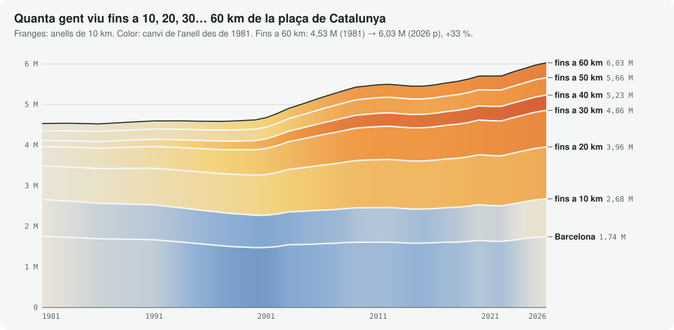
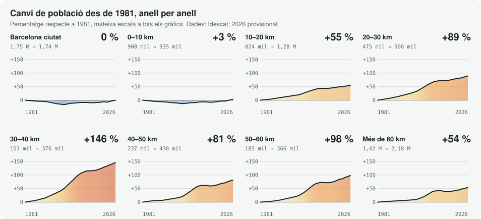
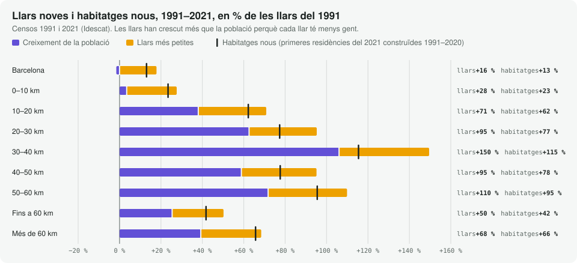

# Creixement al voltant de Barcelona: població, llars i habitatge

## Pregunta central

On s'ha instal·lat la població nova de l'àrea de Barcelona des de 1981, i s'ha construït
prou habitatge per a les llars noves que s'hi han format?

## Marc teòric

La demanda d'habitatge no la fan les persones sinó les llars. Les llars creixen per dues
vies: perquè hi ha més població o perquè cada llar té menys gent (envelliment, més gent
que viu sola). Si l'oferta no segueix, o la població es desplaça on es construeix, o les
llars no es formen (joves a casa dels pares, pisos compartits) i la mida de la llar deixa
de baixar. Separar aquestes vies diu quina part de la pressió sobre preus és demografia i
quina és falta d'oferta.

## Què sabem ja

Totes les xifres són per anells de distància a la plaça de Catalunya. Cada municipi compta
a l'anell on cau el seu centre i Barcelona es compta a part. Les calcula `analisi/` a partir
de les fonts de la secció *Dades*.

**Població** (Idescat, padró i sèries històriques; 2026 és avanç provisional):

| Anell | 1981 | 2026 | Canvi |
|---|---:|---:|---:|
| Barcelona ciutat | 1.752.000 | 1.744.000 | 0 % |
| 0–10 km | 908.000 | 935.000 | +3 % |
| 10–20 km | 824.000 | 1.279.000 | +55 % |
| 20–30 km | 475.000 | 900.000 | +89 % |
| 30–40 km | 153.000 | 376.000 | +146 % |
| 40–50 km | 237.000 | 430.000 | +81 % |
| 50–60 km | 185.000 | 366.000 | +98 % |
| **Fins a 60 km** | **4.534.000** | **6.029.000** | **+33 %** |

Barcelona i la primera corona van perdre gent fins al 2001 (−16 % i −12 %) i després l'han
recuperada. Tot el creixement net de 1981 a 2026 és entre 10 i 60 km.

**Llars i habitatge, fins a 60 km** (Idescat, censos de 1991, 2001, 2011 i 2021):

- Entre 1991 i 2021 les llars han crescut un 50 % i la població que hi viu, un 25 %. La mida
  mitjana de la llar ha baixat de 3,07 a 2,56 persones. Per tant, la meitat de les llars
  noves s'explica per llars més petites, no per més gent.
- Habitatges que el 2021 eren primera residència, per dècada de construcció: 264.000 de
  1991–2000, 305.000 de 2001–2010 i 43.000 de 2011–2020. L'última dècada és un 14 % de
  l'anterior.
- Entre 2011 i 2021 la població ha crescut més que les llars (+3,0 % contra +1,6 %): la mida
  de la llar ha deixat de baixar i a gairebé tots els anells ha pujat una mica.
- La construcció per habitant ha estat sempre molt més baixa al centre: el 2001–2010,
  uns 2 habitatges per 1.000 habitants i any a Barcelona i uns 12 a l'anell de 30–40 km.

## Preguntes

**P1. Per què la població ha crescut entre 10 i 60 km i no al centre?**

- *H1a, oferta:* al centre no hi ha sòl i no s'hi construeix; la gent va on hi ha pisos nous.
- *H1b, preu:* la gent marxa del centre perquè és car, encara que hi hagués pisos.
- *H1c, preferències:* les llars amb fills busquen més espai (cases unifamiliars).
- *Com les separem:* H1a prediu que el creixement de cada municipi segueix els habitatges
  nous, sigui quin sigui el preu. H1b prediu que els qui marxen de Barcelona són sobretot
  llars joves o de renda baixa i que el diferencial de preu centre–perifèria creix abans de
  les sortides. H1c prediu que el creixement de fora es concentra en habitatge unifamiliar
  i en llars amb fills. Dades: migracions entre municipis per edat, preus per municipi i
  habitatges acabats per tipus d'edifici.

**P2. Quina part de la demanda ve de llars més petites i quina de població nova?**

- Mesurat (vegeu més amunt): 1991–2021, fins a 60 km, aproximadament meitat i meitat.
- Pendent: per què són més petites. Envelliment (més llars d'una o dues persones grans)
  contra canvis de convivència a totes les edats. Dada: llars per tipus i edat de la
  persona de referència als censos.

**P3. Per què la mida de la llar ha deixat de baixar des del 2011?**

- *H3a, falta d'habitatge:* llars que no es poden formar (joves a casa, pisos compartits).
- *H3b, composició:* la immigració recent viu en llars més grans.
- *H3c, mètode:* el cens del 2011 es va fer en part per enquesta i el del 2021 a partir de
  registres, i compten les llars diferent.
- *Com les separem:* H3a prediu més joves de 25 a 34 anys que viuen amb els pares i més llars
  amb persones no emparentades, sobretot on es construeix menys. H3b prediu que l'efecte
  desapareix si es compara per nacionalitat de la persona de referència. H3c prediu que la
  ruptura no apareix en una sèrie anual feta amb un sol mètode (per exemple, l'Encuesta
  Continua de Hogares de l'INE, 2013–2020).

## Dades

| Font | Què conté | Nivell | Accés |
|---|---|---|---|
| Idescat, [padró municipal](https://www.idescat.cat/pub/?id=pmh&n=446&lang=ca) | Població a 1 de gener, 1998–2025 | Municipi | Taula descarregable (SSV) |
| Idescat, [sèries històriques](https://www.idescat.cat/pub/?id=shd&n=1341&lang=ca) | Població de fet 1981, 1986, 1991 | Municipi | Taula descarregable |
| Idescat, [cens de població i habitatges](https://www.idescat.cat/pub/?id=censph&n=909&lang=ca) | Llars (taula 7952), grandària mitjana de la llar (450), habitatges principals per any de construcció (309, cens 2021) | Municipi; la 309 només publica els municipis més grans (cobreix més del 99 % de les llars fins a 60 km) | Taules descarregables; `analisi/habitatge_anells.mjs` les baixa |
| INE, contorns municipals via [es-atlas](https://github.com/martgnz/es-atlas) | Polígons dels municipis | Municipi | TopoJSON |

Com es calcula:

- *Llar:* el grup de persones que viuen habitualment al mateix habitatge, siguin família o no
  (definició del cens). Una llar és un habitatge principal.
- *Persones per llar d'un anell:* per a cada municipi, llars × nombre mitjà de persones per
  llar (taules 7952 i 450) dona les persones que viuen en llars; se sumen tots els municipis
  de l'anell i es divideix pel total de llars. No hi compta la gent que viu en
  establiments col·lectius (residències, convents, casernes, presons). Si un municipi no té
  la mida publicada en un cens (12 municipis petits el 2011), es fa servir la mitjana dels
  seus altres censos.
- *Creixement de les llars partit en dues parts:* creixement de les llars = creixement de
  la població en llars + la resta, que només pot venir del canvi en el nombre de persones
  per llar.

Limitacions:

- Els «habitatges nous» només compten els que el 2021 eren primera residència: no inclouen
  els buits, les segones residències ni els enderrocats. Infravaloren la construcció de les
  dècades més antigues.
- No hi ha llars per municipi abans de 1991.
- La sèrie anual d'habitatges acabats per municipi (Departament de Territori) no s'ha pogut
  baixar de manera automàtica; per ara només en tenim dades per comarques.

## Pla

1. Fet: població per anells 1981–2026, llars i mida de la llar 1991–2021, habitatges nous
   per dècada.
2. Comprovar H3c amb l'Encuesta Continua de Hogares (INE) i amb llars del padró si n'hi ha.
3. Habitatges acabats per municipi i any (Departament de Territori) per passar de dècades
   a anys.
4. Migracions entre municipis per edat (Idescat, variacions residencials) per a P1.
5. Preus per municipi (notaris, Ministeri) per separar H1a de H1b.
6. Passar de distàncies a municipis concrets de l'AMB, com demana el mètode del projecte.

## Lectures

Pendent.

## Contingut

```
dades/municipis.json        població per any i contorn de cada municipi (amb el codi Idescat)
dades/habitatge-anells.json llars, població en llars i habitatges nous per anell
analisi/habitatge_anells.mjs baixa els censos d'Idescat i calcula dades/habitatge-anells.json
analisi/figures.mjs         genera figures/*.svg amb el mateix codi de gràfics que la pàgina
figures/                    gràfics estàtics
pagina/                     la pàgina «Catalunya en relleu» (mapa 3D i gràfiques)
```

```bash
node creixement/analisi/habitatge_anells.mjs
python3 -I creixement/pagina/build.py
node creixement/analisi/figures.mjs
python3 -I web/build.py
```






